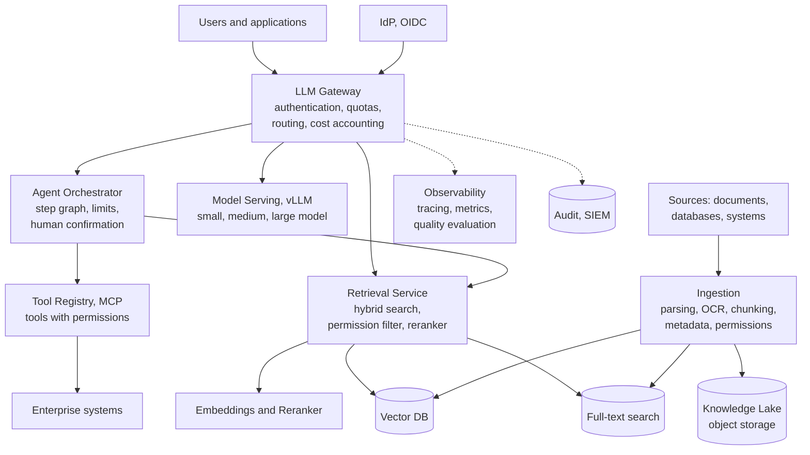

# Reference architecture of an AI platform built from scratch

**English** | [Русский](AI_PLATFORM_ARCHITECTURE.ru.md)

This document answers the questions every AI platform starts with: what really needs to be built, what is not needed yet, which technologies to use, which specialists to hire, how many resources are required and in what order to implement everything. Resource estimates come from the calculator in this repository.

## 0. Principles

1. **Measure the load first, buy GPUs later.** A pilot on cloud GPUs or an API produces real prompts, context lengths and peak traffic. Without them, sizing is accurate only to an order of magnitude.
2. **Model independence.** All calls go through a single gateway, so a model is changed by configuration rather than by rewriting applications.
3. **Security from day one.** Data access rights are checked on every search and every tool call, not added after the pilot.
4. **Quality evaluation as part of the platform.** A set of reference questions and metrics runs on every change of model, prompt or index.
5. **Off the shelf rather than home-made.** Our data, permissions and processes are ours. The gateway, inference engine, vector database and observability are taken off the shelf.

## 1. Questions before the architecture

| Question | Which decision it drives |
|---|---|
| What tasks does the system solve, who are the users, how many | load profile, model classes |
| May data be sent to an external API | cloud, own hardware or hybrid |
| Which knowledge sources, how often they change, what access rights apply | knowledge architecture, permission sync |
| What latency is acceptable: dialogue, agent or batch processing | TTFT and TPOT, and therefore the number of GPUs |
| Should agents change anything in external systems | agent permission model, human confirmation |
| Regulatory and audit requirements | logging, retention, data residency |
| Budget and timeline | phasing, cloud at the start or purchase |

## 2. Containers (C4, level 2)

## 3. Model strategy

| Class | Size | Tasks |
|---|---|---|
| Small | 7–14B | classification, field extraction, routing, query rewriting |
| Medium | around 30B, including MoE | document answers (RAG), most dialogues |
| Large | 70B and above | agent planning, complex reasoning, complex documents |
| Embeddings and reranker | up to 1B | search; multilingual models for non-English text |

- **Open-weight or proprietary.** Criteria: whether data may be sent to a provider, quality in the target language and domain on our own test set, cost at our volume, version control. Open models give control and on-premise operation, proprietary APIs give quality without infrastructure. The decision follows evaluation, not the other way round.
- **Routing.** First by rules per task type, later by a classifier on a small model. The large model is used only where the medium one does not reach the quality threshold.
- **Fallback.** If the large model is unavailable, the request goes to the medium one and the answer is marked. If an external API fails, the request goes to a local model when the data allows it.
- **Fine-tuning.** Only if RAG and prompts do not reach the required quality on the test set and thousands of labelled examples exist. Start with LoRA, move to full fine-tuning only with proven benefit.

## 4. LLM platform

- **Gateway.** A single OpenAI-compatible API, keys and quotas per team, routing between models and providers, cost accounting per request, input and output guards.
- **Inference.** vLLM or similar: continuous batching, paged KV cache, prefix caching. Prefix caching matters most for RAG and agents: shared system prompts and instructions are not recomputed.
- **Scaling.** Model replicas in Kubernetes, autoscaling on queue length and KV cache occupancy rather than CPU load. Tensor parallelism only within a server with NVLink; scaling beyond one server through replicas.
- **Versioning.** A model registry, canary releases and shadow mode for a new version, rollback by gateway configuration.
- **Metrics.** Time to first token, time per output token, queue length, KV cache occupancy, errors, cost, quality on a sample of answers.

## 5. Knowledge and data

- **Ingestion.** Parsing and OCR, structure-aware chunking, metadata, confidentiality labels and permissions from the source system.
- **Storage.** A Knowledge Lake in object storage as the source of truth: indexes can be rebuilt from it.
- **Search.** Hybrid: full-text and vector with rank fusion, then a reranker. The permission filter is passed to both searches together with the query, and results are re-checked in code.
- **Permission sync.** A change of rights in the source reaches the indexes faster than a change of content: a stale permission is more dangerous than stale text.
- **Memory.** Short-term: session context. Long-term: facts about users and tasks with an owner, a retention period and the right to deletion. Not "memory about everything".
- **Reindexing.** Changing the embedding model means recomputing every vector: through a shadow index and a switch-over.

## 6. Agents

- **Orchestration.** A step graph with explicit states. Deterministic steps are done in code; the model decides only where flexibility is needed.
- **Tools.** Through MCP or similar, each with a defined permission model. The user's identity comes from the token, not from parameters the agent passes.
- **Permissions.** Read-only by default. Changes in external systems require human confirmation.
- **Limits.** Number of steps, token and time budget per task, call rate limits.
- **Log.** Every step, tool call and result; code execution only in a sandbox.

## 7. Security and operations

- Authentication via OIDC, attribute-based authorization (ABAC), secrets in Vault.
- Network segmentation: inference servers have no internet access, access only through the gateway.
- Injection protection: quarantine of suspicious chunks at ingestion, input and output guards, data in the prompt marked as data rather than instructions.
- Audit to a SIEM, personal data masked in logs.

| Component | How to restore | RPO | RTO |
|---|---|---|---|
| Model weights | load from the model registry | not relevant | load time, minutes |
| Vector and full-text indexes | snapshots or rebuild from the Knowledge Lake | up to the last snapshot | hours for a rebuild |
| Knowledge Lake | replication and backups | minutes | hours |
| Configurations, prompts, rules | Git | zero | minutes |
| Logs and audit | SIEM | minutes | not critical for the service |

## 8. Infrastructure: cloud, own or hybrid

| Factor | Points to cloud or API | Points to own hardware |
|---|---|---|
| Data | may be sent to an external provider | must not leave the perimeter |
| Load | small, uneven, unknown | large and stable |
| GPUs | needed now | delivery can be awaited |
| Costs | no capital budget | cheaper over a 3-year horizon |
| Team | no GPU operations | SRE and data centre in place |

**Default recommendation:** a pilot on cloud GPUs or an API (for non-confidential data), 2–3 months of measurements, then a purchase decision based on the real profile. A common outcome is hybrid: confidential data is processed on own hardware, peaks and experiments go to the cloud. GPU availability and delivery times must be checked separately: they are a project risk in their own right.

Server guidelines: 8 GPUs per server with NVLink for tensor parallelism; NVMe for fast weight loading; 100–400 Gbit/s networking between servers is needed only when one model is split across several servers, so scaling through replicas is preferable. A server with eight H100-class GPUs draws about 10 kW, which must be agreed with the data centre for power and cooling.

## 9. Economics

The calculator shows that the choice depends on volume. An enterprise assistant for 2,000 employees at indicative prices: API about $48K over 3 years, own hardware from $142K, cloud GPUs from $237K. An agent platform on a 70B-class model: API about $192K, own hardware from $724K. Batch document processing during working hours: cloud rental is cheaper than an API. Prices are indicative; the conclusion that holds at any prices: at low volume an API is cheaper, while own GPUs pay off under large stable load or when data must not leave the perimeter.

Main cost levers:
- quantization of weights and KV cache (FP8, INT4) with quality checked on the test set;
- prefix caching for shared instructions and context;
- routing simple tasks to small models;
- MoE models, which read only active experts at small batch sizes;
- batch jobs during working hours on rented GPUs.

## 10. Phases

| Phase | Duration | What is built | Outcome |
|---|---|---|---|
| 0. Requirements | 2–4 weeks | load profile, quality test set, measurements in the cloud or on an API | justified sizing and model choice |
| 1. MVP | up to 3 months | gateway, one model, RAG with permissions, observability, quality evaluation, baseline security | first users and metrics |
| 2. Expansion | 3–6 months | agents with read-only tools, a second model class, routing | decision on own hardware based on real data |
| 3. Scale | 6–12 months | high availability and DR, cost optimization, agents making changes with confirmation, fine-tuning if proven useful | production operation |

## 11. What not to build yet

- An own GPU cluster before the real load is measured.
- Fine-tuning before a quality test set exists.
- Multi-agent systems: first one agent with good tools.
- An own gateway, vector database or orchestrator if off-the-shelf solutions do the job.
- Universal memory about everything: only specific facts with an owner and a retention period.

## 12. Team and hiring order

1. **LLM platform engineer:** inference, vLLM, model evaluation, gateway.
2. **Backend and data engineer:** knowledge ingestion, integrations, search.
3. **MLOps or SRE:** Kubernetes, GPUs, observability, autoscaling.
4. **Quality analyst:** test sets, metrics, error analysis together with business owners.
5. **AI security specialist:** part-time or external, from the first phase.

Later: agent developers, ML engineers for fine-tuning if it proves justified.

## 13. Risks

| Risk | Mitigation |
|---|---|
| GPU availability and delivery times | cloud at the start, early orders, several suppliers |
| Quality of open models in the target language and domain | test set before choosing a model, routing to the large model |
| Dependence on an API provider | a single gateway, a local model as fallback |
| Leaks through search and agents | permission filter in search, tool permissions, audit, leak tests |
| Growing inference cost | per-request cost accounting in the gateway, prefix caching, routing |
| Shortage of specialists | off-the-shelf components instead of home-made ones, documented decisions |
