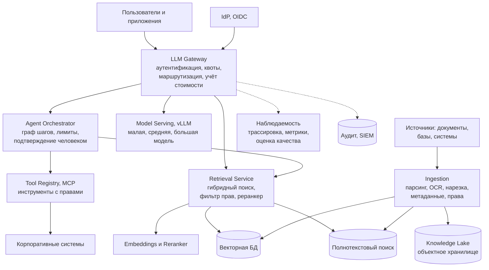

# Референсная архитектура AI-платформы с нуля

[English](AI_PLATFORM_ARCHITECTURE.md) | **Русский**

Документ отвечает на вопросы, с которых начинается любая AI-платформа: что действительно нужно построить, что пока не нужно, какие технологии взять, каких специалистов нанять, сколько ресурсов потребуется и в каком порядке всё реализовывать. Расчёты ресурсов делаются калькулятором из этого репозитория.

## 0. Принципы

1. **Сначала измерить нагрузку, потом покупать GPU.** Пилот на облачных GPU или API даёт реальные промпты, длину контекста и пиковый поток. Без них сайзинг точен только до порядка величины.
2. **Независимость от модели.** Все обращения идут через единый шлюз, поэтому модель меняется конфигурацией, а не переписыванием приложений.
3. **Безопасность с первого дня.** Права доступа к данным проверяются при каждом поиске и каждом вызове инструмента, а не добавляются после пилота.
4. **Оценка качества как часть платформы.** Набор эталонных вопросов и метрик прогоняется при каждой смене модели, промпта или индекса.
5. **Готовое вместо самописного.** Свои у нас данные, права и процессы. Шлюз, движок инференса, векторная база и наблюдаемость берутся готовыми.

## 1. Вопросы до архитектуры

| Вопрос | На какое решение влияет |
|---|---|
| Какие задачи решает система, кто пользователи, сколько их | профиль нагрузки, классы моделей |
| Можно ли передавать данные во внешний API | облако, своё оборудование или гибрид |
| Какие источники знаний, как часто меняются, какие права доступа | архитектура знаний, синхронизация прав |
| Какая задержка допустима: диалог, агент или пакетная обработка | TTFT и TPOT, а значит число GPU |
| Должны ли агенты что-то менять во внешних системах | модель прав агентов, подтверждение человеком |
| Требования регулятора и аудита | журналирование, хранение, локализация данных |
| Бюджет и сроки | этапность, облако на старте или закупка |

## 2. Контейнеры (C4, уровень 2)

## 3. Стратегия моделей

| Класс | Размер | Задачи |
|---|---|---|
| Малая | 7–14B | классификация, извлечение полей, маршрутизация, переписывание запроса |
| Средняя | около 30B, в том числе MoE | ответы по документам (RAG), большая часть диалогов |
| Большая | 70B и больше | планирование агентов, сложные рассуждения, сложные документы |
| Эмбеддинги и реранкер | до 1B | поиск; многоязычные модели для русского текста |

- **Open-weight или проприетарные.** Критерии: можно ли передавать данные провайдеру, качество на русском и в предметной области на нашем наборе проверок, стоимость при нашем объёме, контроль версий. Открытые модели дают контроль и работу в контуре, проприетарные API дают качество без инфраструктуры. Решение принимается по результатам оценки, а не заранее.
- **Маршрутизация.** Сначала правилами по типу задачи, позже классификатором на малой модели. Большая модель включается только там, где средняя не проходит порог качества.
- **Резервирование.** При недоступности большой модели запрос уходит на среднюю с пометкой в ответе. При сбое внешнего API запрос уходит на локальную модель, если данные это допускают.
- **Дообучение.** Только если RAG и промпты не дают нужного качества на наборе проверок и есть тысячи размеченных примеров. Начинать с LoRA, затем полное дообучение при доказанной пользе.

## 4. LLM-платформа

- **Шлюз.** Единый OpenAI-совместимый API, ключи и квоты по командам, маршрутизация между моделями и провайдерами, учёт стоимости на запрос, входные и выходные фильтры.
- **Инференс.** vLLM или аналог: непрерывный батчинг, страничный KV-кэш, кэш префиксов. Кэш префиксов особенно важен для RAG и агентов: общий системный промпт и инструкции не считаются заново.
- **Масштабирование.** Реплики модели в Kubernetes, автоскейлинг по длине очереди и заполнению KV-кэша, а не по загрузке CPU. Tensor parallel только внутри сервера с NVLink; масштабирование сверх одного сервера через реплики.
- **Версионирование.** Реестр моделей, канареечный выпуск и теневой режим для новой версии, откат конфигурацией шлюза.
- **Метрики.** Время до первого токена, время на токен, длина очереди, заполнение KV-кэша, ошибки, стоимость, качество по выборке ответов.

## 5. Знания и данные

- **Загрузка.** Парсинг и OCR, нарезка с учётом структуры документа, метаданные, метки конфиденциальности и права из системы-источника.
- **Хранение.** Knowledge Lake в объектном хранилище как источник истины: индексы можно пересобрать из него.
- **Поиск.** Гибридный: полнотекстовый и векторный со слиянием рангов, затем реранкер. Фильтр прав передаётся в оба поиска вместе с запросом, а результат проверяется повторно в коде.
- **Синхронизация прав.** Изменение прав в источнике доходит до индексов быстрее, чем изменение содержимого: устаревшее право опаснее устаревшего текста.
- **Память.** Краткосрочная: контекст сессии. Долговременная: факты о пользователе и задачах с владельцем, сроком хранения и правом на удаление. Не «память обо всём».
- **Переиндексация.** Смена модели эмбеддингов означает пересчёт всех векторов: через теневой индекс и переключение.

## 6. Агенты

- **Оркестрация.** Граф шагов с явными состояниями. Детерминированные шаги делаются кодом, модель решает только там, где нужна гибкость.
- **Инструменты.** Через MCP или аналог, каждый с описанной моделью прав. Личность пользователя берётся из токена, а не из параметров, которые передаёт агент.
- **Права.** По умолчанию только чтение. Изменения во внешних системах проходят через подтверждение человеком.
- **Лимиты.** Число шагов, бюджет токенов и времени на задачу, ограничение частоты вызовов.
- **Журнал.** Каждый шаг, вызов инструмента и его результат; исполнение кода только в песочнице.

## 7. Безопасность и эксплуатация

- Аутентификация через OIDC, авторизация по атрибутам (ABAC), секреты в Vault.
- Сегментация сети: серверы инференса без выхода в интернет, доступ только через шлюз.
- Защита от инъекций: карантин подозрительных фрагментов при загрузке, входные и выходные фильтры, данные в промпте помечены как данные, а не инструкции.
- Аудит в SIEM, маскирование персональных данных в журналах.

| Компонент | Как восстановить | RPO | RTO |
|---|---|---|---|
| Веса моделей | загрузить из реестра моделей | не важен | время загрузки, минуты |
| Векторный и полнотекстовый индексы | снапшоты или пересборка из Knowledge Lake | до последнего снапшота | часы при пересборке |
| Knowledge Lake | репликация и резервные копии | минуты | часы |
| Конфигурации, промпты, правила | Git | ноль | минуты |
| Журналы и аудит | SIEM | минуты | не критично для сервиса |

## 8. Инфраструктура: облако, своё или гибрид

| Фактор | Склоняет к облаку или API | Склоняет к своему оборудованию |
|---|---|---|
| Данные | можно передавать внешнему провайдеру | нельзя выносить из контура |
| Нагрузка | небольшая, неравномерная, неизвестная | большая и стабильная |
| GPU | нужны сейчас | можно ждать поставку |
| Затраты | нет капитального бюджета | выгоднее на горизонте 3 лет |
| Команда | нет эксплуатации GPU | есть SRE и ЦОД |

**Рекомендация по умолчанию:** пилот на облачных GPU или API (для неконфиденциальных данных), 2–3 месяца измерений, затем решение о закупке по реальному профилю. Частый итог: гибрид, где конфиденциальные данные обрабатываются на своём оборудовании, а пики и эксперименты уходят в облако. Доступность GPU и сроки поставки нужно проверять отдельно: это самостоятельный риск проекта.

Ориентиры для серверов: 8 GPU на сервер с NVLink для tensor parallel; NVMe для быстрой загрузки весов; сеть 100–400 Гбит/с между серверами нужна только при разнесении одной модели на несколько серверов, поэтому лучше масштабироваться репликами. Сервер с восемью GPU уровня H100 потребляет около 10 кВт, что нужно согласовать с ЦОД по питанию и охлаждению.

## 9. Экономика

Калькулятор показывает, что выбор зависит от объёма. Корпоративный ассистент на 2 000 сотрудников при ориентировочных ценах: API около $48 тыс. за 3 года, своё оборудование от $142 тыс., облачные GPU от $237 тыс. Агентная платформа с моделью класса 70B: API около $192 тыс., своё оборудование от $724 тыс. Пакетная обработка документов в рабочие часы: облачная аренда дешевле API. Цены ориентировочные; вывод, который сохраняется при любых ценах: при малом объёме дешевле API, а свои GPU окупаются при большой стабильной нагрузке или когда данные нельзя выносить.

Главные рычаги снижения стоимости:
- квантизация весов и KV-кэша (FP8, INT4) при контроле качества на наборе проверок;
- кэш префиксов для общих инструкций и контекста;
- маршрутизация простых задач на малые модели;
- MoE-модели, которые при малом батче читают только активных экспертов;
- пакетные задачи в рабочие часы на арендованных GPU.

## 10. Этапы

| Этап | Срок | Что строим | Результат |
|---|---|---|---|
| 0. Требования | 2–4 недели | профиль нагрузки, набор проверок качества, замер на облаке или API | обоснованный сайзинг и выбор моделей |
| 1. MVP | до 3 месяцев | шлюз, одна модель, RAG с правами, наблюдаемость, оценка качества, базовая безопасность | первые пользователи и метрики |
| 2. Расширение | 3–6 месяцев | агенты с инструментами только для чтения, второй класс моделей, маршрутизация | решение о своём оборудовании по реальным данным |
| 3. Масштаб | 6–12 месяцев | отказоустойчивость и DR, оптимизация стоимости, агенты с изменениями через подтверждение, дообучение при доказанной пользе | промышленная эксплуатация |

## 11. Что не строить сразу

- Свой GPU-кластер до измерения реальной нагрузки.
- Дообучение моделей до появления набора проверок качества.
- Мультиагентные системы: сначала один агент с хорошими инструментами.
- Собственные шлюз, векторную базу или оркестратор, если готовые решения закрывают задачу.
- Универсальную память обо всём: только конкретные факты с владельцем и сроком хранения.

## 12. Команда и порядок найма

1. **Инженер LLM-платформы:** инференс, vLLM, оценка моделей, шлюз.
2. **Backend и data-инженер:** загрузка знаний, интеграции, поиск.
3. **MLOps или SRE:** Kubernetes, GPU, наблюдаемость, автоскейлинг.
4. **Аналитик качества:** наборы проверок, метрики, разбор ошибок вместе с заказчиками.
5. **Специалист по безопасности ИИ:** на неполную занятость или внешний, с первого этапа.

Позже: разработчики агентов, ML-инженеры для дообучения, если оно окажется оправданным.

## 13. Риски

| Риск | Мера |
|---|---|
| Доступность GPU и сроки поставки | облако на старте, ранний заказ, несколько поставщиков |
| Качество открытых моделей на русском и в домене | набор проверок до выбора модели, маршрутизация на большую модель |
| Зависимость от провайдера API | единый шлюз, локальная модель в резерве |
| Утечки через поиск и агентов | фильтр прав в поиске, права инструментов, аудит, тесты на утечки |
| Рост стоимости инференса | учёт стоимости на запрос в шлюзе, кэш префиксов, маршрутизация |
| Дефицит специалистов | готовые компоненты вместо самописных, документирование решений |
